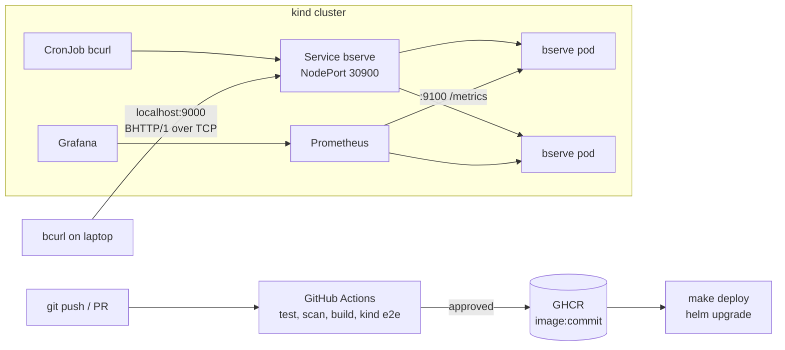

# Design decisions

## Architecture

A request from `bcurl` on the laptop goes to `localhost:9000`, which kind maps to NodePort 30900 on a node. kube-proxy picks one ready bserve pod per TCP connection, and every request on that connection then goes to the same pod. Each pod has two ports: 9000 speaks BHTTP/1, and 9100 speaks plain HTTP for `/metrics`, `/healthz` and `/readyz`.

## Why these choices

**Deployment, not StatefulSet.** bserve keeps no state: the files are baked into the image, and nothing is written. Pods are interchangeable, so a Deployment with 2 replicas fits. A StatefulSet would make sense if each instance owned data, such as uploads.

**Content in the image, not a volume or ConfigMap.** The served files change with the code and get the same version, review and rollback. With large or frequently changing content I would use a PersistentVolume or object storage instead, decoupled from releases.

**No Ingress.** Ingress controllers route HTTP, and BHTTP/1 is a binary TCP protocol, so the Service is exposed directly (NodePort on kind, LoadBalancer on a cloud). Load balancing is per connection, not per request: one client with one long connection always hits one pod. This is fine for many short-lived clients; a protocol-aware proxy would be needed to balance individual requests.

**Probes.** Liveness is a TCP check on 9000: it restarts a pod whose listener is gone, without depending on the metrics thread. Readiness is HTTP `/readyz` on 9100, which turns 503 the moment SIGTERM arrives. An exec probe running `bcurl` would test the real protocol, but would start a Python process every few seconds; the end-to-end protocol check is the smoke CronJob instead.

**Graceful shutdown.** The baseline only stopped on Ctrl+C. On SIGTERM bserve now reports not-ready, keeps serving for `drainSeconds` (5 s) while Kubernetes removes it from the Service endpoints, and then exits. Without this, a rolling update refuses connections that arrive in that gap.

**Release strategy: rolling update with `maxUnavailable: 0`.** A new pod must be ready (and stay ready for `minReadySeconds`) before an old one is removed, so a broken release never reduces capacity: it just stalls. CI proves this by deploying a missing image tag, checking that the old pods still serve, and running `helm rollback`. Blue-green would allow an instant switch back but needs double capacity; canary needs per-request routing, which per-connection balancing cannot do precisely. For a static file server, rolling is enough.

**Traceability.** The image tag is the 7-character commit SHA, never `latest`. That SHA is baked into the image (`BSERVE_VERSION`), exposed as `bserve_build_info{version}`, written in every log line, and sent to clients as the `x-version` header next to `x-served-by` (the pod). Local builds with uncommitted changes are tagged `-dirty`. Drift shows up as more than one version in `bserve_build_info` (alert `BserveMixedVersions`) or in `helm history`.

**One chart, one override file.** `values.yaml` holds production-like defaults; `values-kind.yaml` changes only what differs locally (NodePort and monitoring). Another environment would be another small values file, not a copied set of manifests.

## CI/CD and where the approval sits

Every pull request runs: unit tests on two Python versions, `helm lint` plus a Kubernetes schema check, a Trivy scan of the repo for secrets and misconfigurations, the image build (whose test stage runs the tests again inside the image), a Trivy image scan that fails on fixable critical CVEs, and an end-to-end deploy to a throwaway kind cluster inside the runner with a real `bcurl` request and a rollback test.

Publishing to GHCR happens only after all of that passes, on `main` or a manual run, through the `release` environment, which can require a reviewer's approval. Deployment to my laptop's cluster is `make deploy`, a deliberate manual step: GitHub's runners cannot reach a local kind cluster. With a reachable cluster I would add Argo CD to pull the chart and image tag from git, so the cluster cannot drift from the repository.

## Security

- Container runs as UID 10001 with a read-only root filesystem, no Linux capabilities, no privilege escalation and the RuntimeDefault seccomp profile. The namespace enforces the `restricted` Pod Security Standard, so a pod that loosens any of this is rejected.
- Pods get no service account token: bserve never talks to the Kubernetes API.
- NetworkPolicy: port 9000 open, port 9100 only from the `monitoring` namespace, no egress at all. Metrics also sit on a separate ClusterIP Service, so the NodePort does not expose them.
- Path traversal and symlink escapes were already blocked in the baseline and stay covered by tests.
- No secrets in git. CI uses the short-lived `GITHUB_TOKEN`, with `packages: write` only in the publish job. The Grafana password is generated at install time into a Kubernetes Secret.
- Dependabot keeps the base image and actions current.

## Limitations

- No distributed tracing: the system is a single service with no downstream calls, so a request id carried from `bcurl` into the server log covers what a trace would show. OpenTelemetry would add the first third-party dependency.
- Connections still open after the drain period are closed without a `GOAWAY`; bcurl is short-lived so this does not show in practice.
- Single local cluster; no multi-zone placement beyond spreading pods across kind's two worker nodes.
- The HPA was left out: kind has no metrics-server by default, and a static file server at this load does not need it.
